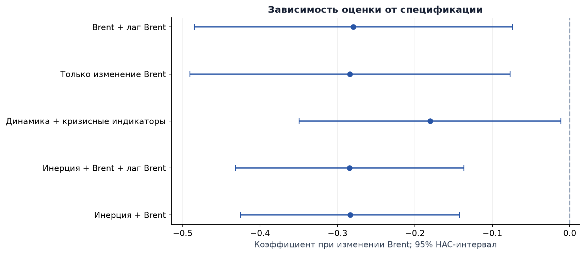

# Нефть и рубль: насколько устойчива связь?

**Добавляет ли изменение Brent информацию о динамике курса с учётом покупательной
способности сверх собственной инерции курса?**

Воспроизводимое исследование на Python: сбор и проверка данных, модели временных рядов,
робастные интервалы, диагностика и проверки устойчивости.



На сохранённом снимке данных:

- Полные годы: **1993-2025**; общая выборка моделей изменений: **1995-2025, 31 наблюдение**.
- Добавление текущего Brent к модели инерции снижает AIC на **9.41**, BIC на **7.97**.
- Коэффициент Brent в основной модели: **-0.284**, 95% HAC-интервал **[-0.425; -0.142]**.
  Рост Brent на 1% связан примерно с уменьшением q на 0.28% при прочих переменных модели.
- Доказательства долгосрочной связи чувствительны к направлению регрессии и числу лагов:
  при log(q) на log(Brent) p-value составляет **0.130 / 0.027 / 0.156** для 0 / 1 / 2 лагов.
  Устойчивую коинтеграцию считать установленной нельзя.

Это связь внутри исторической выборки, не причинная оценка и не готовый прогноз.
Числа относятся к включённому снимку и config.toml; после обновления данных нужно
пересобрать отчёт и пересмотреть этот краткий итог.

**Посмотреть:** [ноутбук](notebooks/research.ipynb) · [отчёт](outputs/report.md) ·
[PDF](outputs/report.pdf) · [методика](docs/methodology.md) · [что исправлено](docs/changes.md).

## Быстрый запуск

Проверенное окружение: **Python 3.12**. Зависимости зафиксированы с точными версиями.

Windows PowerShell:

```powershell
git clone https://github.com/strawberrynka/rub-brent-model.git
cd rub-brent-model
py -3.12 -m venv .venv
.venv\Scripts\python.exe -m pip install -r requirements.txt
.venv\Scripts\python.exe main.py --offline
```

macOS / Linux:

```bash
git clone https://github.com/strawberrynka/rub-brent-model.git
cd rub-brent-model
python3.12 -m venv .venv
.venv/bin/python -m pip install -r requirements.txt
.venv/bin/python main.py --offline
```

Команда без аргументов также работает **без сети**. Она создаёт датасет в data/processed,
таблицы и графики в outputs, единые Markdown/PDF-отчёты и run_manifest.json.
В PDF автоматически используются шрифты из matplotlib, включая кириллицу.

Для намеренного обновления raw-файлов:

```bash
python main.py --refresh
```

Обновление обращается к FRED и World Bank. Ответы всех источников проверяются до
замены файлов; ошибка загрузки не маскируется старым кэшем. Для отдельного снимка:
`python main.py --refresh --raw-dir data/new_snapshot --output-dir build/new_snapshot`.

Дополнительно: `--config config.toml`, `--output-dir build/experiment`, `--no-pdf`.
В примерах с командой `python` подразумевается интерпретатор проектного окружения.

## Данные и показатель

| Величина | Источник | Частота | Единицы |
|---|---|---|---|
| Brent | [FRED DCOILBRENTEU](https://fred.stlouisfed.org/series/DCOILBRENTEU) | Дневная | USD за баррель |
| E: USD/RUB | [FRED CCUSMA02RUM618N / OECD](https://fred.stlouisfed.org/series/CCUSMA02RUM618N) | Месячная | RUB за USD |
| PPP потребления | [World Bank PA.NUS.PRVT.PP](https://data.worldbank.org/indicator/PA.NUS.PRVT.PP) | Годовая | RUB за международный доллар |

**q = E / PPP** - отношение рыночного курса к ППС потребления.
Рост q интерпретируется как относительное ослабление рубля. ППС является статистической
оценкой, а не котировкой конкретной корзины. Отклонение q от единицы не доказывает
рыночной недооценки.

В годе требуется 12 месяцев курса, 12 месяцев Brent и не менее 200 дневных наблюдений Brent.
За 1992 год курс доступен только за июнь-декабрь, поэтому этот год исключён.
Внутренние пропуски годов, дубликаты и неположительные уровни останавливают расчёт.
Подробнее: [покрытие](outputs/tables/data_coverage.csv) и [происхождение снимка](data/raw/PROVENANCE.md).

## Как устроено исследование

1. Проверяем данные и приводим их к годовой частоте.
2. Строим q, логарифмы, изменения и лаги на непрерывном календаре.
3. Сравниваем AR(1) без нефти и модели с Brent на одной выборке.
4. Отдельно рассматриваем уровни, ADF/KPSS и тест Engle-Granger.
5. Проверяем начало выборки, лаги HAC и влияние отдельных наблюдений.
6. Собираем отчёт из того же набора таблиц, который использует ноутбук.

Основная модель задана в config.toml: `ar1_oil`.
Модель с кризисными индикаторами остаётся проверкой устойчивости, а не автоматически
назначенным победителем. Модель уровней не участвует в рейтинге моделей изменений.

## Проверки и ноутбук

Установите зависимости разработки в то же окружение:

```bash
python -m pip install -r requirements-dev.txt
python -m pytest
python -m ruff check .
python scripts/execute_notebook.py
```

Последняя команда выполняет ноутбук с нуля и сохраняет проверенную копию в
build/research.executed.ipynb. В редакторе можно открыть notebooks/research.ipynb
и выбрать Python из .venv.

Тесты запрещают сеть, проверяют дефекты данных, сопоставимость моделей,
сохранность raw-файлов и совпадение численных таблиц между повторными сборками.
GitHub Actions выполняет тесты, сборку отчёта и ноутбук на Python 3.12.

## Структура

```text
config.toml             Период, покрытие и настройки моделей
main.py                 Единая точка запуска
src/                    Загрузка, проверки, модели, графики, отчёт
notebooks/research.ipynb Последовательное объяснение исследования
tests/                  Проверки данных, моделей и полного запуска
data/raw/               Исходный снимок и описание происхождения
data/processed/         Датасет и покрытие календаря
outputs/                Актуальный отчёт, графики, таблицы, манифест
docs/                   Методика и история исправлений
```

## Ограничения

Небольшая годовая выборка; оценки и пересмотры ППС; неучтённые макрофакторы;
смена валютных режимов; чувствительность к ранним годам и настройкам тестов.
Высокий R² сам по себе не подтверждает качество будущего прогноза.
Текущая годовая цена Brent и ППС недоступны в начале прогнозируемого года.

Точная дата загрузки исторических CSV в исходной работе не сохранена.
Манифест честно отмечает её отсутствие и фиксирует контрольные суммы.
Исторические единицы и сопоставимость ранних рядов требуют отдельной предметной проверки.

## Авторы и вклад

Авторы исходного проекта: **Бойко София** и **Шумакова Екатерина**.

Согласно исходному отчёту:
- Екатерина: архитектура, загрузка и подготовка данных, визуализация, сборка pipeline.
- София: эконометрическая часть, регрессии, тесты и интерпретация.

Исходная совместная работа сохранена в истории Git.
Доработка воспроизводимости и методики описана в [списке изменений](docs/changes.md).
