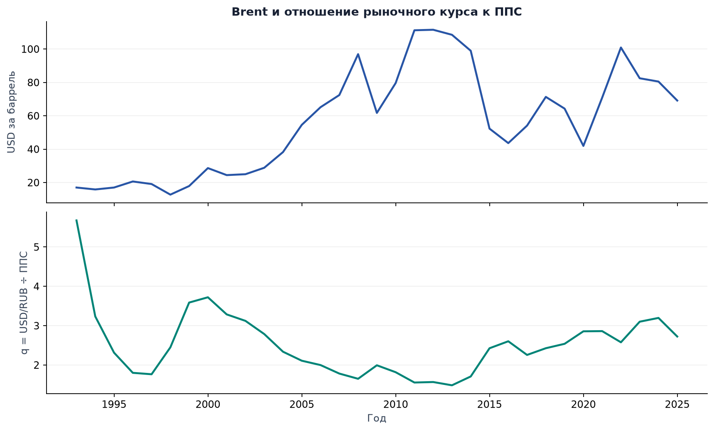
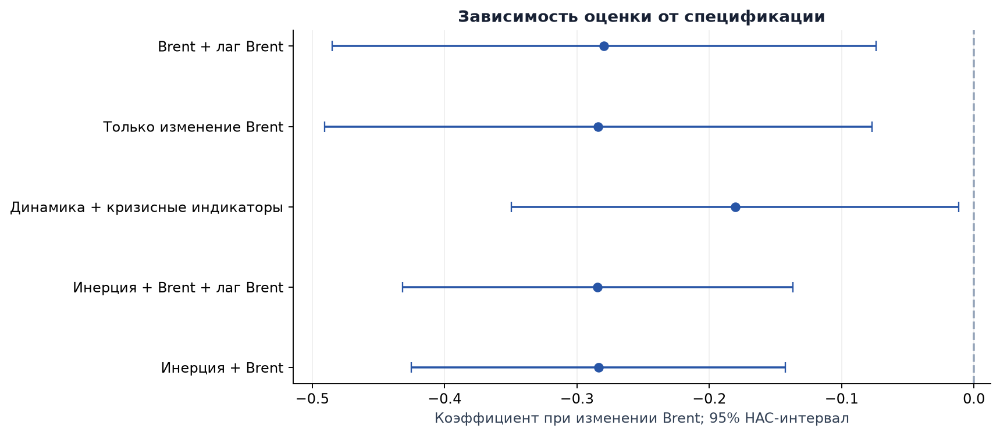
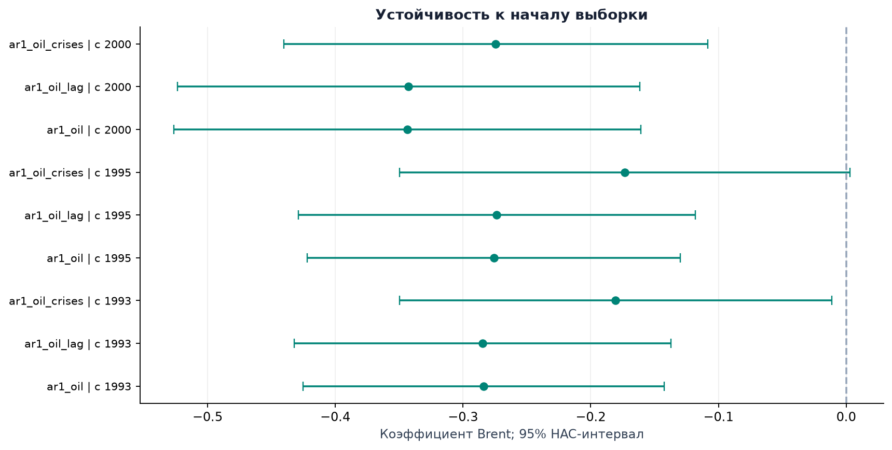

# Нефть и рубль: устойчивость связи

Автоматически сформировано из результатов расчёта.

## Нефть и рубль: результаты

Вопрос: добавляет ли изменение цены Brent информацию об изменении отношения рыночного курса USD/RUB к ППС потребления сверх собственной инерции этого показателя?

Полные годы: 1993-2025; уровни: 33 наблюдения. Общая выборка моделей изменений: 1995-2025, N = 31.

В основной спецификации ar1_oil коэффициент Brent = -0.2838; 95% HAC-интервал [-0.4252; -0.1424], p = 0.0003. Интервал не включает ноль. Это условная связь, не причинный эффект.

Добавление текущего Brent к AR(1): изменение AIC = -9.409, BIC = -7.975 (отрицательное значение означает улучшение). Это качество описания внутри выборки, не проверка прогноза.

|   Год | Причина исключения   |
|------:|:---------------------|
|  1992 | Неполный год курса   |

## Сравнение спецификаций

Все модели в таблице объясняют Δlog(q) на одинаковых годах. ar1 - лаг изменения q; ar1_oil добавляет текущее изменение Brent; ar1_oil_lag - также лаг Brent; ar1_oil_crises - кризисные индикаторы. changes и changes_lag не включают лаг q.

Минимум AIC: ar1_oil; минимум BIC: ar1_oil. Основная спецификация ar1_oil зафиксирована в конфигурации, а не выбрана по минимальному p-value. Модель уровней сохранена отдельно и не участвует в этом рейтинге.

HAC, число лагов: 1; поправка малой выборки: включена; t-интервалы. BG - F-версия теста Breusch-Godfrey с 1 лагом; неотклонение гипотезы не доказывает отсутствия автокорреляции.

| Модель         |   N |   Adj. R² |      AIC |      BIC |   BG p |
|:---------------|----:|----------:|---------:|---------:|-------:|
| ar1_oil        |  31 |    0.4411 | -37.4749 | -33.1729 | 0.5123 |
| ar1_oil_crises |  31 |    0.4929 | -37.2711 | -27.2332 | 0.3630 |
| ar1_oil_lag    |  31 |    0.4211 | -35.5098 | -29.7739 | 0.5294 |
| ar1            |  31 |    0.2203 | -28.0661 | -25.1982 | 0.4546 |
| changes        |  31 |    0.2057 | -27.4902 | -24.6222 | 0.0521 |
| changes_lag    |  31 |    0.2105 | -26.7645 | -22.4626 | 0.0540 |

## Устойчивость и влиятельные годы

Начало выборки и число лагов HAC меняются по заранее заданной сетке config.toml. При смене начала выборки разности и лаги пересчитываются заново; постоянные кризисные индикаторы исключаются с записью в таблицу результатов.

При исключении по одному наблюдению из фиксированной матрицы основной модели коэффициент Brent меняется от -0.3296 до -0.2412. Это диагностическая проверка влияния; её нельзя считать временной кросс-валидацией. Ниже - пять наибольших значений расстояния Кука; наблюдения автоматически не удаляются.

|       Год |   Cook D |   Leverage |
|----------:|---------:|-----------:|
| 1999.0000 |   0.5404 |     0.1721 |
| 1998.0000 |   0.1300 |     0.1149 |
| 2016.0000 |   0.1155 |     0.1732 |
| 1995.0000 |   0.0967 |     0.2925 |
| 2015.0000 |   0.0773 |     0.2449 |

## Стационарность и долгосрочная связь

ADF: константа и фиксированные 2 лага. Нулевая гипотеза ADF - единичный корень; KPSS - стационарность около константы, число лагов выбирается автоматически. Знаки >= и <= обозначают границы табличных p-value KPSS. При малой выборке и структурных разрывах мощность тестов ограничена.

Основной Engle-Granger: log(q) на log(Brent), константа; число лагов фиксировано: 1. p = 0.0268: нулевая гипотеза отсутствия коинтеграции отвергается на уровне 5%. Таблица показывает чувствительность к направлению регрессии и лагам. Интерпретация теста предполагает I(1) для обоих рядов; здесь это не установленный факт.

| Ряд                      |   ADF p | KPSS p   |
|:-------------------------|--------:|:---------|
| log_brent                |  0.5124 | 0.0159   |
| log_basket_real_usd_rub  |  0.1832 | >=0.1000 |
| dlog_brent               |  0.0183 | >=0.1000 |
| dlog_basket_real_usd_rub |  0.0008 | >=0.1000 |

| Зависимый ряд           |   Лаг |   Статистика |      p |
|:------------------------|------:|-------------:|-------:|
| log_basket_real_usd_rub |     0 |      -2.9233 | 0.1296 |
| log_basket_real_usd_rub |     1 |      -3.5687 | 0.0268 |
| log_basket_real_usd_rub |     2 |      -2.8311 | 0.1560 |
| log_brent               |     0 |      -1.2542 | 0.8431 |
| log_brent               |     1 |      -1.9426 | 0.5582 |
| log_brent               |     2 |      -1.6016 | 0.7202 |

## Методика, источники и воспроизведение

q = E / PPP, где E - RUB за USD, PPP - RUB за международный доллар по потреблению. Рост q соответствует относительному ослаблению рубля. ППС - статистическая оценка, а отклонение q от единицы само по себе не доказывает рыночной недооценки.

В годе требуется 12 месяцев курса, 12 месяцев Brent и не менее 200 наблюдений Brent. Для курса используется равновзвешенное среднее месячных средних; для нефти - среднее доступных дневных цен. Это различие весов сохраняется явно. Пропуски внутри итогового календаря останавливают расчёт.

Ограничения: малая годовая выборка, пересмотры и задержка публикации ППС, неучтённые факторы, смена валютных режимов и влияние ранних лет. Кризисные индикаторы учитывают выбранные периоды, но не выделяют причинный нефтяной канал. Brent текущего года неизвестен в начале этого года; модель не является готовым прогнозом.

Режим данных: offline. Дата исходной загрузки: не зафиксирована в историческом снимке. Контрольные суммы источников, конфигурация, версии библиотек и состояние Git сохранены в run_manifest.json. Markdown и PDF строятся из одного набора результатов.

Повторение: python main.py --offline. Обновление источников: python main.py --refresh. Проверки: python -m pytest. Параметры: config.toml.

Авторы исходного исследования: Бойко София и Шумакова Екатерина. Сведения о распределении исходной работы приведены в README.

Источники: FRED DCOILBRENTEU (https://fred.stlouisfed.org/series/DCOILBRENTEU); FRED CCUSMA02RUM618N (https://fred.stlouisfed.org/series/CCUSMA02RUM618N); World Bank PA.NUS.PRVT.PP (https://data.worldbank.org/indicator/PA.NUS.PRVT.PP).

Методические справки: https://www.statsmodels.org/stable/generated/statsmodels.tsa.stattools.coint.html ; https://stat.ethz.ch/R-manual/R-devel/library/stats/html/AIC.html
